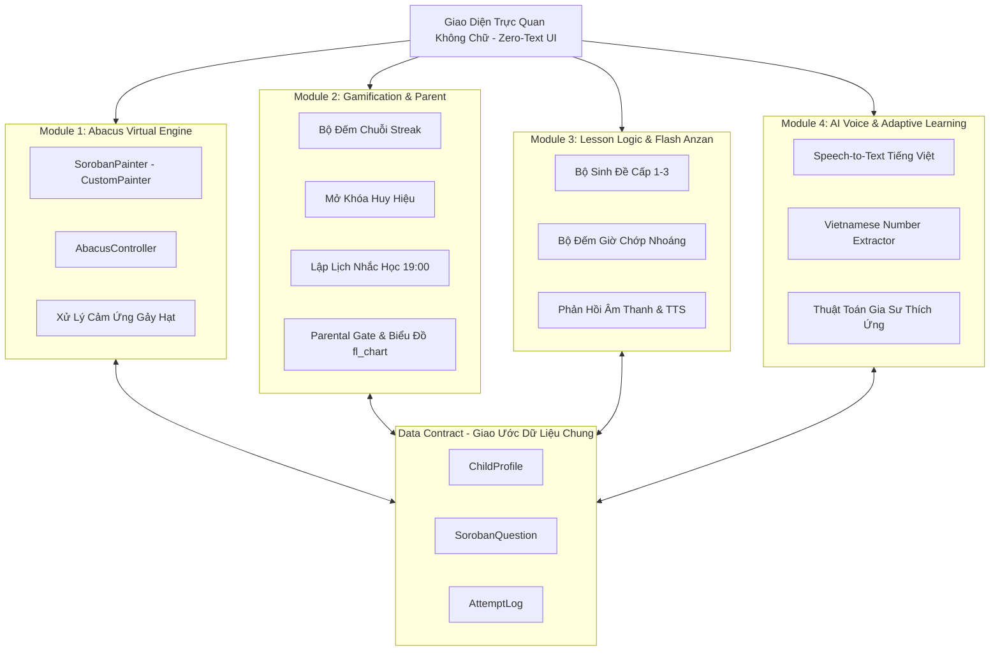

# Đặc Tả Kiến Trúc Hệ Thống (System Architecture Specification)

Dự án: **Soroban Kids App**  
Nhóm: **Nhóm 15 - Lớp 65KTPM**

---

## 1. Sơ Đồ Kiến Trúc Tổng Thể (System Architecture)

---

## 2. Giao Ước Dữ Liệu Cốt Lõi (Data Contract)

> **Lưu ý nghiệp vụ:** Toàn bộ hệ thống được thiết kế **chỉ giới hạn ở phép Cộng và phép Trừ** (phù hợp với lứa tuổi 4–6 tuổi). Tuyệt đối không sinh phép nhân hay chia. Mọi phép toán đều đảm bảo kết quả không âm ($0 \le \text{kết quả} \le 99$) để bé thao tác chính xác trên bàn tính ảo.

Để 4 thành viên phát triển độc lập không bị xung đột, các lớp dữ liệu cốt lõi được định nghĩa sẵn trong `lib/shared/entities/`:

### 2.1. `ChildProfile`
- `id`: Mã định danh bé.
- `name`: Tên bé.
- `age`: Độ tuổi (4 - 6).
- `streakCount`: Số ngày duy trì chuỗi học tập liên tiếp.
- `lastActiveDate`: Ngày hoạt động gần nhất để tính streak.
- `unlockedBadgeIds`: Danh sách ID các huy hiệu bé đã đạt được.
- `currentLevel`: Cấp độ hiện tại (1: Nhận diện, 2: Anh bạn nhỏ/lớn, 3: Flash Anzan).

### 2.2. `SorobanQuestion`
- `id`: Mã câu hỏi.
- `level`: Cấp độ bài toán (1, 2, 3).
- `operands`: Danh sách các số hạng trong phép tính (ví dụ: `[2, 3, -1]`).
- `expectedAnswer`: Kết quả chính xác.
- `displayType`: Dạng câu hỏi (`recognition`, `formula`, `flashAnzan`).
- `flashSpeedMs`: Tốc độ hiển thị mỗi số trong chế độ Flash Anzan (500ms - 2000ms).

### 2.3. `AttemptLog`
- `questionId`: Mã câu hỏi tương ứng.
- `userAnswer`: Kết quả bé trả lời (nhập qua bàn tính hoặc qua giọng nói).
- `isCorrect`: Đúng hay sai.
- `responseTimeMs`: Thời gian phản hồi (mili-giây).
- `answeredVia`: Phương thức trả lời (`voice` hoặc `abacus_touch`).
- `timestamp`: Thời điểm thực hiện.

---

## 3. Kiến Trúc Đồ Họa Tương Tác Finger Math (Finger Math Engine)

Hệ thống mô phỏng trực quan chuẩn quốc tế **Flash Card 1D (Right Hand - Hàng đơn vị & Left Hand - Hàng chục)** giúp trẻ 4–6 tuổi ghi nhớ và thao tác số học thông qua chính đôi bàn tay:

### 3.1. Bảng mã hóa số trên bàn tay (0 đến 9)
- **Số 0 (Cái Búa ✊):** Toàn bộ 5 ngón gập lại thành nắm đấm.
- **Số 1 (Cây Nến ☝️):** Bung 1 ngón trỏ.
- **Số 2 (Tai Thỏ ✌️):** Bung 2 ngón (trỏ + giữa).
- **Số 3 (Cái Nĩa 🤟):** Bung 3 ngón (trỏ + giữa + áp út).
- **Số 4 (Cái Quạt ✋):** Bung 4 ngón dài, ngón cái cụp.
- **Số 5 (Anh Béo 👍):** **Ngón cái xòe ra (giá trị = 5)**, 4 ngón dài cụp lại.
- **Số 6 (Súng Nhỏ 🔫):** Ngón cái (5) + 1 ngón trỏ (1) = 6.
- **Số 7 (Súng Lớn 👈):** Ngón cái (5) + 2 ngón (2) = 7.
- **Số 8 (Cua Kẹp 🦀):** Ngón cái (5) + 3 ngón (3) = 8.
- **Số 9 (Bàn Tay Xòe 🖐️):** Bung toàn bộ 5 ngón (5 + 4 = 9).

### 3.2. Cơ chế 2 bàn tay tính toán phạm vi 0 đến 99
- **Tay Phải (Right Hand - RH):** Đảm nhiệm hàng đơn vị ($0 \dots 9$).
- **Tay Trái (Left Hand - LH):** Đảm nhiệm hàng chục ($00, 10, 20 \dots 90$).
- Ví dụ: Số `37` = Tay trái giơ 3 ngón (30) + Tay phải giơ súng lớn (7).

### 3.3. Hiện thực hóa các công thức toán tư duy
#### a. Công thức Anh Bạn Nhỏ (Cặp số có tổng bằng 5: 1-4, 2-3)
- Phép cộng (+1, +2, +3, +4): Khi không đủ ngón dài để xòe $\rightarrow$ Xòe ngón cái (Anh béo +5) và gập các ngón thừa:
  - $+4 = +5 - 1$ (Xòe anh béo 5, cụp 1 ngón dài)
  - $+3 = +5 - 2$ (Xòe anh béo 5, cụp 2 ngón dài)
  - $+2 = +5 - 3$ (Xòe anh béo 5, cụp 3 ngón dài)
  - $+1 = +5 - 4$ (Xòe anh béo 5, cụp 4 ngón dài)
- Phép trừ (-1, -2, -3, -4): Khi không đủ ngón dài để gập $\rightarrow$ Gập ngón cái (Anh béo -5) và xòe các ngón tương ứng:
  - $-1 = -5 + 4$ (Cụp anh béo 5, xòe 4 ngón dài)
  - $-2 = -5 + 3$ (Cụp anh béo 5, xòe 3 ngón dài)
  - $-3 = -5 + 2$ (Cụp anh béo 5, xòe 2 ngón dài)
  - $-4 = -5 + 1$ (Cụp anh béo 5, xòe 1 ngón dài)

#### b. Công thức Anh Bạn Lớn (Cặp số có tổng bằng 10: 9-1, 8-2, 7-3,...)
- Phép cộng qua 10 (+9, +8, +7,...): Khi tay phải hết ngón $\rightarrow$ Bung 1 ngón tay trái (hàng chục +10) và cụp anh bạn lớn ở tay phải:
  - $+9 = +10 - 1$ (Tay trái +1, tay phải -1)
  - $+8 = +10 - 2$ (Tay trái +1, tay phải -2)
  - $+7 = +10 - 3$ (Tay trái +1, tay phải -3)
- Phép trừ qua 10: Gập 1 ngón tay trái (-10) và xòe anh bạn lớn ở tay phải.

---

## 4. Xử Lý Giọng Nói & Thuật Toán AI Tiếng Việt

### 4.1. Bộ bóc tách số tiếng Việt (Vietnamese Number Extractor)
Trẻ 4-6 tuổi thường trả lời kèm đại từ xưng hô hoặc từ dạ thưa:
- Câu nói: *"Dạ thưa cô kết quả bằng mười lăm ạ"* $\rightarrow$ lọc bỏ từ đệm $\rightarrow$ trích xuất: `15`.
- Câu nói: *"Bằng hai mươi mốt"* $\rightarrow$ trích xuất: `21`.
- Câu nói: *"Số năm"* $\rightarrow$ trích xuất: `5`.

### 4.2. Thuật toán Gia sư thích ứng (Adaptive Learning)
Hệ thống tính điểm trượt (Rolling Evaluation) trên 5 câu hỏi gần nhất:
- **Tăng độ khó:** Nếu tỷ lệ đúng $\ge 80\%$ và thời gian phản hồi trung bình $< 2.5$ giây:
  - Tự động tăng số lượng phép tính hoặc giảm tốc độ chớp số Flash Anzan thêm 200ms.
- **Hạ độ khó / Trợ giúp:** Nếu tỷ lệ đúng $< 50\%$ hoặc thời gian phản hồi liên tục $> 6$ giây:
  - Tự động chuyển về bài tập hướng dẫn trực quan (Highlight từng hạt cần gảy) và động viên bé bằng lời nói.
